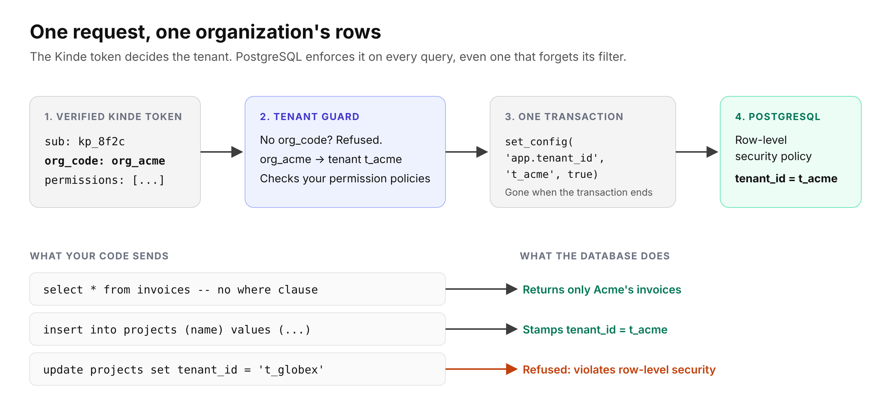

# kinde-tenant-guard

Keep each Kinde organization's data separate. kinde-tenant-guard takes the active organization from a verified Kinde token and limits every database query to that organization's rows. On PostgreSQL, row-level security enforces it, so a query that forgets its filter still cannot read or change another organization's data. On Convex, which has no row-level security, it wraps `ctx.db` so every read goes through an index on the tenant field. It works with Drizzle, Prisma and Convex.



## Contents

- [Why it exists](#why-it-exists)
- [Install](#install)
- [Quick start with Drizzle and PostgreSQL](#quick-start-with-drizzle-and-postgresql)
- [Quick start with Prisma and PostgreSQL](#quick-start-with-prisma-and-postgresql)
- [Quick start with Convex](#quick-start-with-convex)
- [What is protected on PostgreSQL](#what-is-protected-on-postgresql)
- [Permissions](#permissions)
- [Background jobs](#background-jobs)
- [SQLite, MySQL and databases without row-level security](#sqlite-mysql-and-databases-without-row-level-security)
- [Check the database at startup](#check-the-database-at-startup)
- [Audit events and errors](#audit-events-and-errors)
- [Prove isolation with testIsolation()](#prove-isolation-with-testisolation)
- [Lint for database access outside the guard](#lint-for-database-access-outside-the-guard)
- [AI agent tools](#ai-agent-tools)
- [API](#api)
- [What this release covers](#what-this-release-covers)

## Why it exists

In a B2B app, many organizations share one database. Kinde tells your app which organization a user is working in: the `org_code` claim in their access token. Everything after that is your code's job. Every query has to filter by that organization, and every insert has to record it:

```ts
const { orgCode } = await getOrganization();
const rows = await db.select().from(invoices); // forgot .where(eq(invoices.tenantId, ...))
```

Kinde's SDKs did their part correctly, and the bug is in the one line they cannot see. Every route, job and script has to remember the filter, and a single miss shows one customer another customer's invoices.

kinde-tenant-guard moves the filter out of your route code:

- It reads the active organization from the verified token, never from the request, and maps it to your own tenant ID.
- It refuses to run tenant queries when there is no organization, or when the organization is not one of your tenants.
- On PostgreSQL, it sets the tenant for one transaction, and row-level security policies filter every query on the tenant's tables: selects, joins, relational queries, counts and raw SQL. It also stamps inserts and rejects writes that name another tenant.
- It checks the Kinde permissions your policies require for each action.
- It gives background jobs an explicit, audited system context instead of an unscoped database client.

## Install

```bash
npm install kinde-tenant-guard
```

Node 20 or later. The Drizzle adapter needs `drizzle-orm` 0.36 or later, the Prisma adapter needs Prisma 7 or later with a driver adapter, such as `@prisma/adapter-pg`, and the Convex adapter needs `convex` 1.46 or later.

## Quick start with Drizzle and PostgreSQL

### 1. Add a tenant column to each tenant table

`tenantIdColumn()` is a text column whose default is the tenant of the current transaction, so the database stamps new rows itself:

```ts
// db/schema.ts
import { pgTable, serial, text, integer } from "drizzle-orm/pg-core";
import { tenantIdColumn } from "kinde-tenant-guard/drizzle";

// Maps each Kinde organization to your own tenant. Shared by all tenants.
export const tenants = pgTable("tenants", {
  id: text("id").primaryKey(),
  kindeOrgCode: text("kinde_org_code").notNull().unique(),
});

export const projects = pgTable("projects", {
  id: serial("id").primaryKey(),
  tenantId: tenantIdColumn(),
  name: text("name").notNull(),
});

export const invoices = pgTable("invoices", {
  id: serial("id").primaryKey(),
  tenantId: tenantIdColumn(),
  projectId: integer("project_id").notNull().references(() => projects.id),
  amount: integer("amount").notNull(),
});
```

Keep your own tenant IDs. The Kinde organization code is an external identifier, and the `tenants` table maps one to the other.

### 2. Create the guard

```ts
// db/tenant-guard.ts
import { eq } from "drizzle-orm";
import { createTenantGuard, definePolicies } from "kinde-tenant-guard";
import { drizzleAdapter } from "kinde-tenant-guard/drizzle";
import { db } from "./client";
import { invoices, projects, tenants } from "./schema";

export const tenantAdapter = drizzleAdapter(db, {
  tables: { projects, invoices },
  tenantColumn: "tenantId",
});

export const tenantGuard = createTenantGuard({
  adapter: tenantAdapter,
  resolveTenant: async (orgCode) =>
    (await db.select({ id: tenants.id }).from(tenants).where(eq(tenants.kindeOrgCode, orgCode)))[0]?.id ?? null,
  policies: definePolicies({
    projects: { tenant: "required", permissions: { read: "projects:read", create: "projects:create", update: "projects:update", delete: "projects:delete" } },
    invoices: { tenant: "required", permissions: { read: "invoices:read", create: "invoices:create" } },
  }),
});
```

### 3. Turn on row-level security

`tenantAdapter.migrationSql()` returns the SQL for the registered tables. For each one it enables and forces row-level security, adds the tenant policy, and sets the column default. Save it as a migration, for example with `npx drizzle-kit generate --custom --name=tenant-guard`, and paste in the output of:

```ts
console.log(tenantAdapter.migrationSql());
```

```sql
ALTER TABLE "public"."projects" ENABLE ROW LEVEL SECURITY;
ALTER TABLE "public"."projects" FORCE ROW LEVEL SECURITY;
CREATE POLICY tenant_guard_isolation ON "public"."projects" FOR ALL
  USING ("tenant_id" = NULLIF(current_setting('app.tenant_id', true), '')::text OR current_setting('app.tenant_guard_system', true) = 'on')
  WITH CHECK (...the same...);
ALTER TABLE "public"."projects" ALTER COLUMN "tenant_id" SET DEFAULT NULLIF(current_setting('app.tenant_id', true), '')::text;
```

### 4. Connect as a role that row-level security applies to

PostgreSQL skips row-level security for superusers and for roles with `BYPASSRLS`. If your app connects as the `postgres` superuser, or any role with `BYPASSRLS`, every policy is ignored. Run migrations as the owner, and give the app its own login role:

```sql
CREATE ROLE app_user LOGIN PASSWORD '...';
GRANT USAGE ON SCHEMA public TO app_user;
GRANT SELECT, INSERT, UPDATE, DELETE ON ALL TABLES IN SCHEMA public TO app_user;
GRANT USAGE, SELECT ON ALL SEQUENCES IN SCHEMA public TO app_user;
```

`tenantGuard.assertSafe()` checks this for you. See [Check the database at startup](#check-the-database-at-startup).

### 5. Use it in a request

Build a principal from the verified token, then run the request's queries inside `withTenant()`. With Kinde's Next.js SDK, `getAccessToken()` returns the token's verified claims:

```ts
// app/api/projects/route.ts
import { getKindeServerSession } from "@kinde-oss/kinde-auth-nextjs/server";
import { isTenantGuardError, principalFromClaims } from "kinde-tenant-guard";
import { tenantGuard } from "@/db/tenant-guard";
import { invoices, projects } from "@/db/schema";

export async function GET() {
  const claims = await getKindeServerSession().getAccessToken();
  if (!claims) return Response.json({ error: "Sign in first" }, { status: 401 });

  try {
    const data = await tenantGuard.withTenant(principalFromClaims(claims), async (tenant) => {
      tenant.authorize("projects", "read");
      return tenant.db.query.projects.findMany({ with: { invoices: true } });
    });
    return Response.json(data);
  } catch (error) {
    if (isTenantGuardError(error)) return Response.json({ error: error.message }, { status: error.status });
    throw error;
  }
}
```

In any other server, verify the bearer token against your Kinde domain:

```ts
import { verifyKindeToken } from "kinde-tenant-guard";

const principal = await verifyKindeToken(bearerToken, {
  issuer: "https://acme.kinde.com",
  audience: "https://api.acme.com",
});
```

`tenant.db` is your Drizzle client inside one transaction, with the tenant set, so you write ordinary Drizzle queries and get only the tenant's rows. `tenant.table(projects)` offers the same operations as one-line helpers that also check your permission policies:

```ts
await tenantGuard.withTenant(principal, async (tenant) => {
  const open = await tenant.table(projects).findMany({ where: eq(projects.name, "Portal") });
  await tenant.table(projects).insert({ name: "Mobile app" }); // tenant stamped, needs projects:create
  await tenant.table(projects).delete({ where: eq(projects.id, 7) }); // needs projects:delete
});
```

## Quick start with Prisma and PostgreSQL

Steps 3 and 4 above, the migration and the app role, are the same for Prisma. The differences are the schema and the adapter.

### 1. Give each tenant model a tenant field that defaults to the transaction's tenant

```prisma
model Project {
  id       Int       @id @default(autoincrement())
  tenantId String    @default(dbgenerated("NULLIF(current_setting('app.tenant_id', true), '')")) @map("tenant_id")
  name     String
  invoices Invoice[]
}

model Invoice {
  id        Int     @id @default(autoincrement())
  tenantId  String  @default(dbgenerated("NULLIF(current_setting('app.tenant_id', true), '')")) @map("tenant_id")
  projectId Int
  amount    Int
  project   Project @relation(fields: [projectId], references: [id])
}
```

The default lets PostgreSQL stamp the tenant on every insert, including nested creates, so your code never sets `tenantId`.

### 2. Create the guard

```ts
import { createTenantGuard } from "kinde-tenant-guard";
import { prismaAdapter } from "kinde-tenant-guard/prisma";
import { prisma } from "./prisma";

export const tenantAdapter = prismaAdapter(prisma, {
  models: { projects: "Project", invoices: "Invoice" },
  tenantField: "tenantId",
});

export const tenantGuard = createTenantGuard({
  adapter: tenantAdapter,
  resolveTenant: async (orgCode) => (await prisma.tenant.findUnique({ where: { kindeOrgCode: orgCode } }))?.id ?? null,
  policies, // the same definePolicies() as above
});
```

Create a migration with `npx prisma migrate dev --create-only --name tenant_guard`, paste in `tenantAdapter.migrationSql()`, and apply it.

### 3. Use it in a request

```ts
const projects = await tenantGuard.withTenant(principal, (tenant) =>
  tenant.db.project.findMany({ include: { invoices: true } }),
);
```

`tenant.db` is your Prisma client inside one transaction, with the tenant set. A query extension also adds the tenant to every `where`, stamps `create`, `createMany` and `upsert`, refuses data that names another tenant, and checks your policies on every operation: `tenant.db.project.deleteMany()` needs `projects:delete`. The client refuses to run once the `withTenant()` callback has finished. Each scope is one interactive transaction, and Prisma's default timeout is 5 seconds. Pass `transactionOptions: { timeout: 15000 }` to `prismaAdapter()` for longer requests.

## Quick start with Convex

Convex has no SQL and no row-level security, so the guard wraps `ctx.db` instead. Every read on a tenant table goes through an index whose first field is the tenant field, and the guard fills in that field. Writes are stamped with the tenant, and writes to another tenant's documents are refused.

### 1. Give each tenant table a tenant field and an index that starts with it

```ts
// convex/schema.ts
import { defineSchema, defineTable } from "convex/server";
import { v } from "convex/values";

export default defineSchema({
  tenants: defineTable({ kindeOrgCode: v.string(), name: v.string() }).index("by_org", ["kindeOrgCode"]),
  projects: defineTable({ tenantId: v.string(), name: v.string(), slug: v.string() })
    .index("by_tenant", ["tenantId"])
    .index("by_tenant_slug", ["tenantId", "slug"])
    .searchIndex("search_name", { searchField: "name", filterFields: ["tenantId"] }),
  plans: defineTable({ name: v.string() }),
});
```

### 2. Create the guard

```ts
// convex/tenant.ts
import { convexTenantGuard } from "kinde-tenant-guard/convex";
import schema from "./schema";

export const tenants = convexTenantGuard({
  schema,
  tables: ["projects"],
  shared: ["plans"],
  tenantField: "tenantId",
  policies, // the same definePolicies() as above, keyed by table name
  resolveTenant: async (ctx, orgCode) =>
    (await ctx.db.query("tenants").withIndex("by_org", (q) => q.eq("kindeOrgCode", orgCode)).unique())?._id ?? null,
});
```

The guard reads the schema when it is created. It throws if a tenant table is missing or has no index that starts with the tenant field.

The principal comes from `ctx.auth.getUserIdentity()`. Set up Kinde as a custom JWT provider in `convex/auth.config.ts` and send Convex the Kinde access token, which carries `org_code` and `permissions`. The guard reads those claims from the identity. If your setup puts them somewhere else, pass `principal(ctx)` to `convexTenantGuard()` and build the principal yourself.

### 3. Use it in a query or mutation

```ts
// convex/projects.ts
import { mutation, query } from "./_generated/server";
import { v } from "convex/values";
import { tenants } from "./tenant";

export const list = query({
  args: {},
  handler: (ctx) => tenants.withTenant(ctx, (t) => t.db.query("projects").collect()),
});

export const bySlug = query({
  args: { slug: v.string() },
  handler: (ctx, { slug }) =>
    tenants.withTenant(ctx, (t) => t.db.query("projects").withIndex("by_tenant_slug", (q) => q.eq("slug", slug)).unique()),
});

export const create = mutation({
  args: { name: v.string(), slug: v.string() },
  handler: (ctx, args) => tenants.withTenant(ctx, (t) => t.db.insert("projects", args)),
});
```

In `withIndex()`, the range starts after the tenant field, so `q.eq("slug", slug)` is the second field of `by_tenant_slug`. `t.db` is read-only in queries and a writer in mutations, with the same types as `ctx.db` except that `insert` does not need the tenant field.

| Case | Result |
| --- | --- |
| `query()` with no index, `.order()`, `.take()` or `.fullTableScan()` | Only the tenant's documents, through the first tenant index |
| `withIndex()` on an index that starts with the tenant field | The guard fills in the tenant |
| `withIndex()` on any other index | Refused with `UNSAFE_QUERY` |
| `withSearchIndex()` on a search index that lists the tenant field in `filterFields` | Filtered to the tenant |
| `withSearchIndex()` on any other search index | Refused with `UNSAFE_QUERY` |
| `get()` of another tenant's document | `null` |
| `insert()` without a tenant value | Stamped with the tenant |
| `insert()` or `patch()` that names another tenant | Refused with `CROSS_TENANT_WRITE` |
| `patch()`, `replace()` or `delete()` of another tenant's document | Refused with `CROSS_TENANT_WRITE` |
| A table that is not registered | Refused with `UNSCOPED_TABLE` |
| A write to a shared table | Refused with `FORBIDDEN` |
| `t.db` used after the `withTenant()` callback has finished | Refused with `UNSAFE_QUERY` |

Every row is a test that runs the functions with `convex-test`. `get`, `patch`, `replace` and `delete` work with both the `(table, id)` and the older `(id)` forms, and `ctx.db.table(name)` is scoped the same way.

For internal functions and crons, use `tenants.withSystem(ctx, { reason: "nightly report", tenantId }, (s) => ...)`. With a `tenantId`, `s.db` is scoped to that tenant. Without one, it is `ctx.db`.

## What is protected on PostgreSQL

Every row below is a test that runs against a real PostgreSQL server, connected as an ordinary app role.

| Case | Result | Tested with |
| --- | --- | --- |
| `select` or `findMany` with no `where` clause | Only the tenant's rows | Drizzle, Prisma |
| Insert without a tenant value, including nested creates | Stamped with the tenant by the database | Drizzle, Prisma |
| Insert that names another tenant | Refused | Drizzle, Prisma |
| Update that moves a row to another tenant | Refused | Drizzle, Prisma |
| Update or delete aimed at another tenant's row | Changes nothing | Drizzle, Prisma |
| Delete with no filter | Deletes only the tenant's rows | Drizzle, Prisma |
| Upsert that conflicts with another tenant's row | The other tenant's row is unchanged | Drizzle, Prisma |
| Joins, counts, aggregates, `groupBy` and relational queries | Only the tenant's rows on every table | Drizzle, Prisma |
| Relation from a tenant row to another tenant's row | Not returned | Drizzle, Prisma |
| Raw SQL | Only the tenant's rows | Drizzle, Prisma |
| Prepared statements, nested transactions and savepoints | Only the tenant's rows | Drizzle |
| 24 concurrent requests from two organizations on a pool of 4 connections | Each sees only its own tenant | Drizzle, Prisma |
| A pooled connection after a request | Keeps no tenant, so a query outside the guard returns no rows | Drizzle |
| A token with no `org_code` | Refused with `NO_ORGANIZATION` | All adapters, in the core |
| An organization with no tenant | Refused with `UNKNOWN_TENANT` | All adapters, in the core |
| A request parameter that names another organization | Refused with `ORGANIZATION_MISMATCH` | All adapters, in the core |
| A user who belongs to several organizations (`org_codes`) | Reaches only the active one, from `org_code` | All adapters, in the core |

The tenant is set with `set_config('app.tenant_id', ..., true)`. The `true` makes it local to the transaction, so when the transaction ends the connection goes back to the pool with no tenant.

Row-level security protects you from a query that forgets its filter. It does not stop code that sets `app.tenant_id` itself with raw SQL. Keep tenant selection inside the guard.

## Permissions

Kinde decides who the user is and which permissions they have. Your policies decide what each permission allows:

```ts
const policies = definePolicies({
  invoices: { tenant: "required", permissions: { read: "invoices:read", create: "invoices:create" } },
  plans: { tenant: "global" },
  billingAccounts: { tenant: "system" },
});
```

| `tenant` | Meaning |
| --- | --- |
| `"required"` | Every operation belongs to the active tenant |
| `"global"` | Shared by all tenants, such as a list of plans |
| `"system"` | Only reachable through `withSystem()` |

Access is refused unless it is allowed. An action without a permission in the policy is refused: `invoices` above has no `update`, so nobody can update invoices. A resource without a policy is refused with `POLICY_MISSING`. The tenant check and the permission check are separate: `projects:read` lets a user read projects in their active organization, never in another one.

`tenant.table(...)` checks the policy for you. With `tenant.db`, call `tenant.authorize("invoices", "read")` first, or use `tenant.can()` to decide what to show.

## Background jobs

Jobs have no user token, so they use an explicit system context. It needs a reason, and each use sends an audit event:

```ts
// One tenant, for example a nightly job per organization
await tenantGuard.withSystem({ reason: "nightly invoice reminders", tenantId: "t_acme" }, async (system) => {
  await system.db.select().from(invoices);
});

// Every tenant, for example a platform report
await tenantGuard.withSystem({ reason: "monthly revenue report" }, async (system) => {
  await system.db.select().from(invoices);
});
```

## SQLite, MySQL and databases without row-level security

The Drizzle adapter works with SQLite and MySQL, but only PostgreSQL can enforce the boundary in the database. Without row-level security, the guard limits only the queries that go through `tenant.table(...)`, and `tenant.db` is not available, because a query on the raw client would not be limited to the tenant:

```ts
const tenantAdapter = drizzleAdapter(sqliteDb, { tables: { projects }, tenantColumn: "tenantId" });

await tenantGuard.withTenant(principal, (tenant) => tenant.table(projects).findMany());
```

The Prisma adapter keeps `tenant.db` on SQLite and MySQL, because its query extension adds the tenant to every operation on a registered model. It refuses what it cannot limit: `include` or `select` of a relation to a tenant model, nested writes to one, and raw SQL. Query and write those models on their own instead.

| Database | Protection |
| --- | --- |
| PostgreSQL, Neon, Supabase Postgres | Row-level security on every query, plus the adapter's own filters |
| SQLite, Turso, MySQL | The adapter's filters only: Drizzle's scoped helpers, or Prisma's query extension |

## Check the database at startup

`verify()` checks that the database enforces isolation: the app's role is not a superuser and does not have `BYPASSRLS`, and every registered table has row-level security enabled, forced, and with the tenant policy. `assertSafe()` throws when a check fails, with the SQL that fixes it:

```ts
await tenantGuard.assertSafe();
```

```
The database does not enforce tenant isolation:
  - database role: The app connects as "postgres", which is a superuser, so PostgreSQL skips row-level security on every query.
    Fix: Connect as a role without SUPERUSER or BYPASSRLS, ...
```

Run it when the server starts, or in CI against a copy of the production setup.

## Audit events and errors

Every refusal and every system access goes to `onAudit`:

```ts
createTenantGuard({
  // ...
  onAudit: (event) => logger.warn(event),
});
```

```json
{ "type": "access.denied", "code": "UNKNOWN_TENANT", "organizationCode": "org_initech", "subject": "kp_8f2c", "requestId": "...", "at": "..." }
{ "type": "system.access", "reason": "nightly invoice reminders", "tenantId": "t_acme", "requestId": "...", "at": "..." }
```

Refusals are `TenantGuardError`s with a `code` and an HTTP `status`:

| Code | Status | When |
| --- | --- | --- |
| `INVALID_PRINCIPAL` | 401 | The token did not verify, or the principal has no subject or issuer |
| `NO_ORGANIZATION` | 403 | The token has no active organization |
| `ORGANIZATION_MISMATCH` | 403 | The request asked for another organization than the token's |
| `UNKNOWN_TENANT` | 403 | `resolveTenant()` found no tenant |
| `FORBIDDEN` | 403 | A policy requires a permission the user does not have |
| `POLICY_MISSING` | 403 | No policy covers the resource |
| `CROSS_TENANT_WRITE` | 403 | A scoped insert or update named another tenant |
| `UNSCOPED_TABLE` | 403 | A table that is not registered with the adapter |
| `UNSAFE_TOOL_INPUT` | 403 | Agent tool input named a tenant or organization, or the tool does not exist |
| `SYSTEM_REASON_REQUIRED` | 500 | `withSystem()` without a reason |
| `UNSAFE_QUERY` | 403 | A query the adapter cannot limit, such as raw SQL without row-level security, or use of the Prisma client after its scope ended |
| `UNSAFE_DATABASE` | 500 | `assertSafe()` found a problem |

## Prove isolation with testIsolation()

`testIsolation()` checks, in your own test suite, that two Kinde organizations cannot reach each other's records. It mints a real Kinde-shaped token for each organization with [kinde-testkit](https://www.npmjs.com/package/kinde-testkit), creates a record as each one, and then tries every operation you describe across the boundary.

```bash
npm install --save-dev kinde-testkit
```

```ts
import { testIsolation } from "kinde-tenant-guard/testing";

it("keeps Acme and Globex apart", async () => {
  await testIsolation(tenantGuard, {
    organizations: ["org_acme", "org_globex"],
    resources: {
      projects: {
        create: async (t) => (await t.db.insert(projects).values({ name: "Isolation test" }).returning())[0],
        list: (t) => t.db.select().from(projects),
        get: async (t, id) => (await t.db.select().from(projects).where(eq(projects.id, id as number)))[0],
        update: (t, row) => t.db.update(projects).set({ name: "changed" }).where(eq(projects.id, row.id)),
        remove: (t, row) => t.db.delete(projects).where(eq(projects.id, row.id)),
      },
    },
  });
});
```

Both organization codes must map to tenants in your test database. Each function runs inside `withTenant()` for one organization, and these are the checks:

| Check | Passes when |
| --- | --- |
| Organization | A token with no active organization, and a request that names the other organization, are refused |
| Create | Each organization can create its record |
| Read | Each organization's `list()` has its own record and not the other's |
| Get | Organization A reading B's record by ID gets nothing or is refused |
| Update | Organization A's update of B's record leaves it unchanged |
| Delete | Organization A's delete of B's record leaves it in place |

`get`, `update` and `remove` are optional. When a check fails, `testIsolation()` throws a `TenantIsolationError` that names each leak, such as `projects read: org_acme can see org_globex's record 42`, and has the full report on `error.report`. The test users get every permission in your policies, unless you pass `permissions`.

On Convex, or to test your HTTP API, leave out the guard. Each function then gets the organization, with an `identity` for `convex-test` and a signed `token` for an `Authorization` header:

```ts
await testIsolation({
  organizations: ["org_acme", "org_globex"],
  permissions: ["projects:read", "projects:write", "projects:delete"],
  resources: {
    projects: {
      create: (org) => t.withIdentity(org.identity).mutation(api.projects.create, { name: "Isolation test" }),
      list: (org) => t.withIdentity(org.identity).query(api.projects.list, {}),
      remove: (org, row) => t.withIdentity(org.identity).mutation(api.projects.remove, { id: row._id }),
    },
  },
});
```

## Lint for database access outside the guard

The guard protects the queries that go through it. The ESLint rule `no-unguarded-db` finds the ones that do not: calls on your raw database client, and `ctx.db` in Convex functions.

```js
// eslint.config.js
import tenantGuard from "kinde-tenant-guard/eslint";

export default [
  tenantGuard.configs.recommended,
  // Migrations and seed scripts use the raw client on purpose.
  { files: ["db/migrate.ts", "db/seed.ts"], rules: { "kinde-tenant-guard/no-unguarded-db": "off" } },
];
```

```ts
const rows = await db.select().from(invoices);
// error: `db` is the raw database client, so this query is not limited to a tenant.

export const list = query({ handler: (ctx) => ctx.db.query("projects").collect() });
// error: `ctx.db` reaches every tenant's documents.
```

The rule allows the raw client where the guard needs it: in the arguments to `createTenantGuard()`, `convexTenantGuard()`, `drizzleAdapter()` and `prismaAdapter()`, and in a function named `resolveTenant`. By default it treats `db` and `prisma` as raw clients and `ctx` as the Convex context. Change that with options:

```js
{ rules: { "kinde-tenant-guard/no-unguarded-db": ["error", { clients: ["database"], convexContexts: ["ctx"] }] } }
```

## AI agent tools

An agent that reads or changes tenant data is one prompt injection away from asking for another tenant's records. `defineTenantTools()` makes the tenant come from the signed-in user, never from the model:

```ts
import { defineTenantTools } from "kinde-tenant-guard/agents";

export const projectTools = defineTenantTools(tenantGuard, {
  listProjects: {
    resource: "projects",
    action: "read",
    description: "List the organization's projects.",
    run: (t) => t.db.select().from(projects),
  },
  renameProject: {
    resource: "projects",
    action: "update",
    description: "Rename a project.",
    run: (t, input: { id: number; name: string }) => t.db.update(projects).set({ name: input.name }).where(eq(projects.id, input.id)),
  },
});
```

For each agent run, bind the tools to the user's principal and give the model only the tools their permissions allow:

```ts
import { tool } from "ai";
import { z } from "zod";

const session = projectTools.forPrincipal(principal);
const schemas = { listProjects: z.object({}), renameProject: z.object({ id: z.number(), name: z.string() }) };

const tools = Object.fromEntries(
  session.available.map((t) => [t.name, tool({ description: t.description, inputSchema: schemas[t.name], execute: t.execute })]),
);
```

Every call:

- Opens its own `withTenant()` scope for the user, so the database only reaches their organization.
- Checks the tool's permission before it runs, and writes a refusal to the audit log.
- Refuses input that contains `tenantId`, `orgCode`, `organizationId` or a similar key at any depth, with `UNSAFE_TOOL_INPUT`. Change the list with the `forbiddenInputKeys` option.

`session.call(name, input)` runs a tool by name and refuses names that are not defined, for frameworks that route tool calls themselves. `tenantGuard.can(principal, resource, action)` gives the same permission answer outside a scope, for example to decide which buttons to show.

## API

From `kinde-tenant-guard`:

- `createTenantGuard({ adapter, resolveTenant, policies, onAudit })` returns `{ withTenant, withSystem, can, verify, assertSafe, policies }`.
- `withTenant(principal, fn, { requestId, organizationCode })` runs `fn(tenant)`. `tenant` has the adapter's scope, plus `context`, `can(resource, action)`, `authorize(resource, action)` and `deny(error)`, which writes your own refusal to the audit log.
- `can(principal, resource, action)` checks the policies without opening a scope.
- `withSystem({ reason, tenantId }, fn)` runs `fn(system)` with system access.
- `principalFromClaims(claims)` and `verifyKindeToken(token, { issuer, audience })` build a `KindePrincipal`. Machine-to-machine tokens become `{ type: "machine", subject: <client ID> }`.
- `definePolicies(policies)`, `TenantGuardError` and `isTenantGuardError(error, code)`.

From `kinde-tenant-guard/drizzle`:

- `drizzleAdapter(db, { tables, tenantColumn, rls })`. `rls` is on by default for PostgreSQL. The adapter has `migrationSql()` and `verify()`.
- The scope has `db` (the transaction, with row-level security only) and `table(t)`, which returns `findMany`, `findFirst`, `count`, `insert`, `update` and `delete`.
- `tenantIdColumn(name)` and `tenantRlsSql(tables, tenantColumn)`.

From `kinde-tenant-guard/prisma`:

- `prismaAdapter(prisma, { models, tenantField, rls, tenantColumnType, transactionOptions })`. `rls` is on by default when the client uses PostgreSQL. The adapter has `migrationSql()` and `verify()`.
- The scope has `db`, the guarded Prisma client.
- `TENANT_DEFAULT_SQL`, the expression for `@default(dbgenerated(...))`.

From `kinde-tenant-guard/convex`:

- `convexTenantGuard({ schema, tables, tenantField, shared, resolveTenant, policies, onAudit, principal })` returns `{ withTenant, withSystem, verify }`.
- `withTenant(ctx, fn, options)` runs `fn(tenant)` with `tenant.db`, the scoped database. `withSystem(ctx, { reason, tenantId }, fn)` runs `fn(system)`.
- `principal(ctx)` is optional. By default the principal comes from `ctx.auth.getUserIdentity()`.

From `kinde-tenant-guard/testing`:

- `testIsolation(guard, { organizations, resources, permissions, roles, testkit })` and `testIsolation({ organizations, resources, permissions, roles, testkit })` return the report or throw a `TenantIsolationError`.

From `kinde-tenant-guard/agents`:

- `defineTenantTools(guard, definitions, { forbiddenInputKeys })` returns `{ forPrincipal, definitions }`. `forPrincipal(principal)` returns `{ available, tools, call }`.

From `kinde-tenant-guard/eslint`:

- The default export is the ESLint plugin, with `configs.recommended` and the `no-unguarded-db` rule.

## What this release covers

| Capability | Status |
| --- | --- |
| Kinde principal from verified claims or a token, including M2M | Implemented |
| Fail-closed tenant resolution | Implemented |
| Permission policies with required, global and system resources | Implemented |
| System context for background jobs, with audit events | Implemented |
| Drizzle with PostgreSQL row-level security | Implemented, tested against PostgreSQL 17 with pooled connections |
| Drizzle scoped helpers for SQLite and MySQL | Implemented, tested with SQLite |
| Startup check for roles and policies | Implemented |
| Prisma with PostgreSQL row-level security | Implemented, tested against PostgreSQL 17 with Prisma 7 |
| Prisma query extension for SQLite and MySQL | Implemented, tested with SQLite |
| Convex adapter with scoped `ctx.db`, indexes and search indexes | Implemented, tested with `convex-test` |
| Isolation tests with `testIsolation()` | Implemented, tested on Drizzle with PostgreSQL and on Convex |
| ESLint rule for database access outside the guard | Implemented, tested with ESLint 10 |
| Tenant-safe AI agent tools | Implemented, tested on Drizzle with PostgreSQL |

## License

MIT
