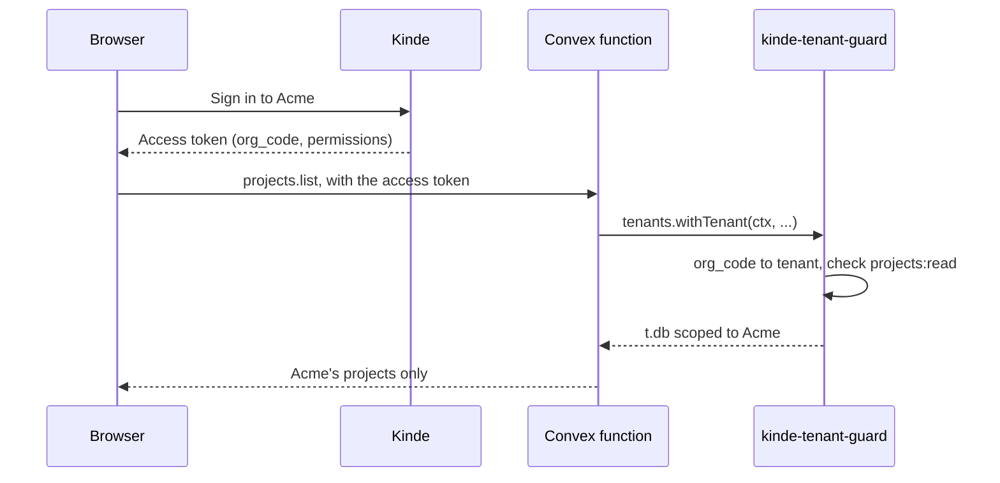

# kinde-tenant-guard on Convex

A small projects app where every Kinde organization sees only its own projects. It signs in with Kinde, stores data in Convex, and uses [kinde-tenant-guard](https://www.npmjs.com/package/kinde-tenant-guard) so that every query and mutation reaches only the active organization's documents.



What it shows:

- **The tenant comes from the token.** Each function calls `tenants.withTenant(ctx, ...)`, which reads `org_code` from the Kinde access token and gives the function a `t.db` that only reaches that organization's documents.
- **Permissions per organization.** The same user can be a Project admin in one organization and a Project editor in another. Deleting a project needs `projects:delete`, so the editor sees a `FORBIDDEN` refusal.
- **Switching organizations.** The organization menu calls `login({ orgCode })`, which signs in to the other organization without a prompt, and the list changes with it. It does not use `switchOrg()`, because that leaves the API audience out of the new token and Convex rejects it.
- **What Convex received.** The panel at the bottom shows the claims Convex got from Kinde and the principal the guard built from them.

## How it fits together

| File | What it does |
| --- | --- |
| `convex/auth.config.ts` | Tells Convex to accept the Kinde access token for your API audience |
| `convex/tenant.ts` | Creates the guard: the tenant table, the tenant field and the permission each action needs |
| `convex/projects.ts` | The list, create and delete functions, each inside `tenants.withTenant()` |
| `convex/tenants.ts` | Registers an organization as a tenant the first time someone signs in to it |
| `src/useAuthFromKinde.ts` | Hands Convex the Kinde access token, not the ID token |
| `tests/isolation.test.ts` | Proves with `testIsolation()` that two organizations cannot reach each other's projects |

Convex receives the access token because it carries `org_code` and `permissions`. Kinde's ID token does not, so the guard would refuse every request with `NO_ORGANIZATION`.

## Set up Kinde

1. Create a **Front-end and mobile** application. Set the allowed callback and logout URLs to `http://localhost:3000`.
2. Under **Settings > APIs**, add an API with an audience such as `https://tenant-guard-convex-example.api`, and authorize your application for it.
3. Under **Settings > Permissions**, add `projects:read`, `projects:create` and `projects:delete`.
4. Under **Settings > Roles**, add a role with all three permissions and a role with only `projects:read` and `projects:create`.
5. Create two organizations, add a user to both, and give the user a different role in each.

## Run it

```bash
npm install
cp .env.example .env.local
```

Fill in `.env.local` with your Kinde domain, the application's client ID and the API audience. Then start a local Convex deployment and tell it about Kinde:

```bash
npx convex init
npx convex env set KINDE_ISSUER_URL https://your-business.kinde.com
npx convex env set KINDE_AUDIENCE https://tenant-guard-convex-example.api
npm run dev
```

When `npx convex init` asks, you can run Convex locally without an account. Open http://localhost:3000 and sign in.

## Check it

```bash
npm test         # testIsolation() and a permission refusal, through convex-test
npm run check    # npx kinde-tenant-guard check: no database access outside the guard
```
